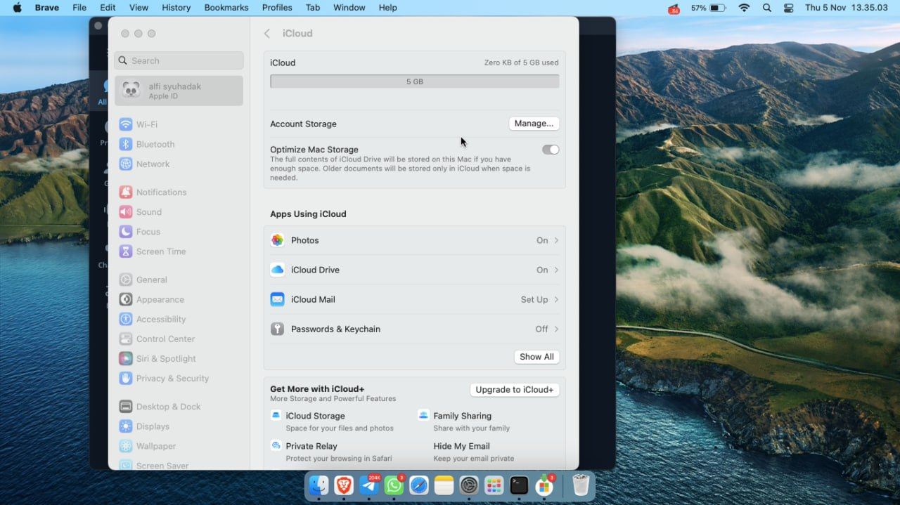
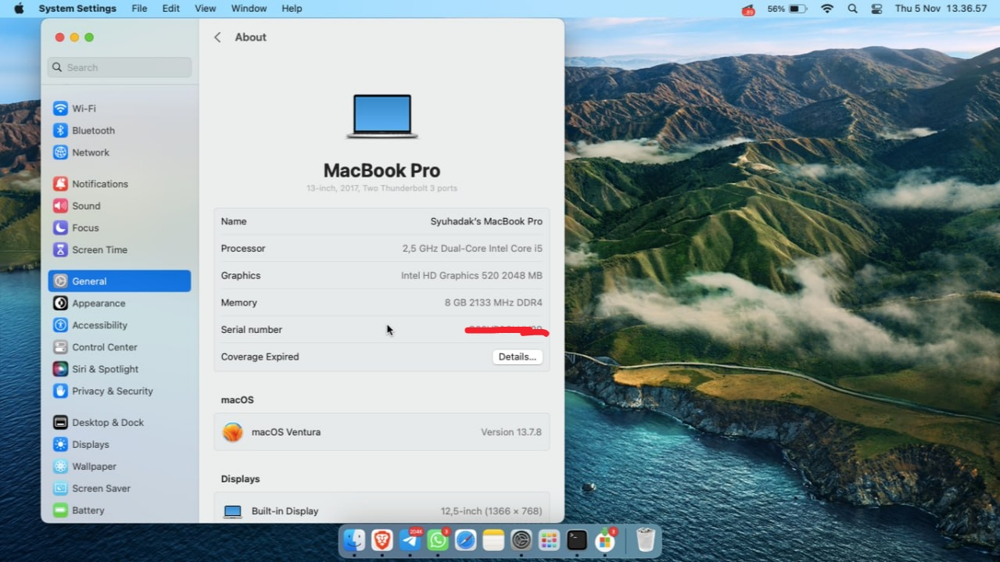
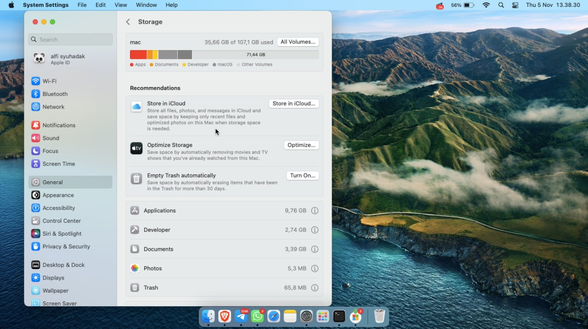

<!-- Name Card -->

# ThinkPad X260 — macOS Ventura (OpenCore)

EFI OpenCore untuk Lenovo ThinkPad X260 dengan prosesor Intel Core i5 generasi ke-6. Utamanya untuk macOS Ventura, tapi juga mendukung Monterey dan Big Sur.

## Spesifikasi
| Spesifikasi | Konfigurasi |
| ----------- | ----------- |
| Laptop | Lenovo ThinkPad X260 |
| Prosesor | Intel Core i5 6th Gen (Skylake) |
| Grafis Terintegrasi | Intel HD Graphics 520 |
| Memori | 8GB DDR4 |
| Penyimpanan | SSD SATA |
| Kartu Wireless | Intel AC-8260 Dual Band + Bluetooth |
| Bootloader | OpenCore |
| Versi Bootloader | v0.8.6 |

## Screenshot

  <kbd> V E N T U R A &nbsp; 1
    
  <kbd></kbd></kbd>

  <kbd> V E N T U R A &nbsp; 2
    
  <kbd></kbd></kbd>

  <kbd> V E N T U R A &nbsp; 3
    
  <kbd></kbd></kbd>

## Apa yang Berfungsi?
- QE/CI Intel HD Graphics 520 `Ventura`
- Power Management CPU `Ventura`
- Sleep, Shutdown, Restart `Ventura`
- Audio Speaker & Earphone `Ventura`
- WiFi (Intel AC-8260) `Ventura`
- Bluetooth `Ventura`
- Trackpad, TrackPoint, Gestur `Ventura`
- Keyboard & Tombol Fn `Ventura`
- Indikator Baterai `Ventura`
- Tombol Brightness `Ventura`
- Kamera `Ventura`
- Port USB `Ventura`
- SD Card Reader `Ventura`
- dll

## Tidak Berfungsi
- Fingerprint Reader — tidak didukung macOS
- AirDrop / Handoff / Continuity — tidak didukung kartu WiFi Intel

## Versi macOS
- Ventura (Ditest, OpenCore)
- Monterey (Ditest, OpenCore)
- Big Sur (Ditest, OpenCore)

> AirportItlwm sudah dikonfigurasi berdasarkan versi macOS yang dipakai.
> Jika ada masalah, coba versi lain. Kext untuk Big Sur, Monterey dan Ventura sudah tersedia.
> Cukup Enable dan Disable sesuai kebutuhan di config.plist.

## Pengaturan BIOS
- `Security -> Security Chip`: **Disabled**;
- `Memory Protection -> Execution Prevention`: **Enabled**;
- `Virtualization -> Intel Virtualization Technology`: **Enabled**;
- `Virtualization -> Vt-directed IO`: **Disabled**;
- `Internal Device Access -> Bottom Cover Tamper Detection`: harus **Disabled**;
- `Anti-Theft -> Computrace -> Current Setting`: **Disabled**;
- `Secure Boot -> Secure Boot`: **Disabled**;
- `UEFI/Legacy Boot`: **UEFI Only**;
- `CSM Support`: **No**.

## Sebelum Memulai
Ikuti panduan Dortania untuk membuat USB installer macOS (recovery).
Panduan instalasi macOS bisa ditemukan di link berikut, [`klik di sini`](https://dortania.github.io/OpenCore-Install-Guide/installer-guide/winblows-install.html#downloading-macos)

## Kredit:
- [Dortania](https://dortania.github.io/OpenCore-Install-Guide/)
- [Simprecicchiani](https://github.com/simprecicchiani)
- [WinLinMacTutorials](https://www.youtube.com/channel/UCR51utxUtFk8OJQP_bBBJsw)
- [Vcyzteen](https://github.com/vcyzteen)
- [r/hackintosh](https://www.reddit.com/r/hackintosh/)
- [r/unixporn](https://github.com/racka98)
